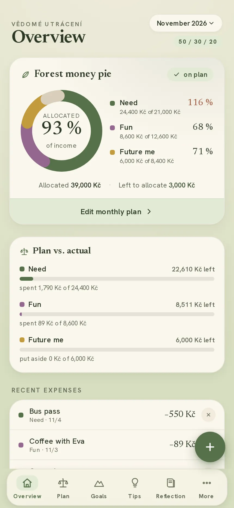
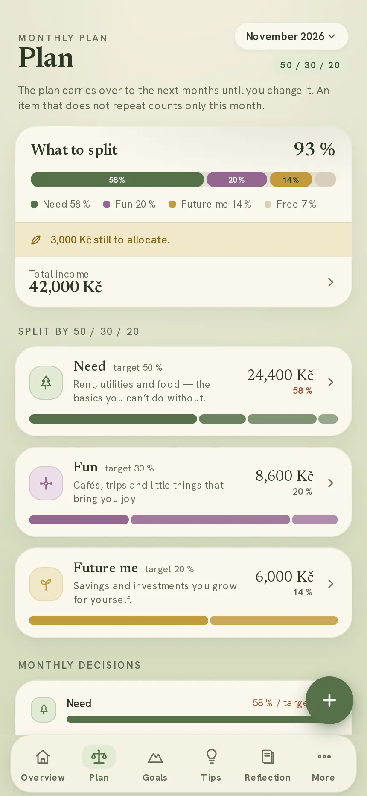
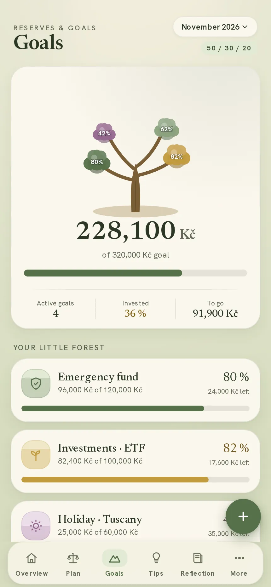
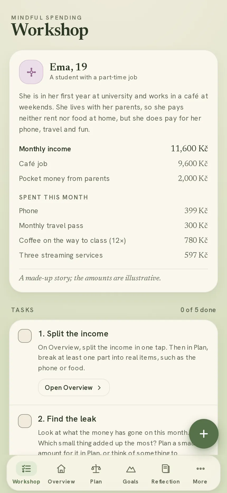

# Vědomé utrácení — Mindful Spending

**A calm, local-first money-planning app built on the 50/30/20 rule: what you need, what brings you joy, and what you send to your future self. Goals grow as a tree, tips teach without preaching, and your data never leaves your browser.**

[](https://vedome-utraceni.vercel.app/)
[](LICENSE)
[](https://github.com/usnea-communitas/vedome-utraceni/actions/workflows/ci.yml)
[](LICENSE-ASSETS.md)
[](#localisation)

**Use it:** <https://vedome-utraceni.vercel.app/> — installable as a PWA, no account, no server.

Vědomé utrácení (Czech for *mindful spending*) is an open-source project built and maintained by [Martin Pazderník](https://github.com/martinpazdernik-source). It is used on its own and as a companion to financial-literacy workshops.

---

<p align="center">
  
  
  
  
</p>

## What it does

- **One plan, three jars.** Monthly income is split into *Need*, *Fun* and *Future me* with the proven 50/30/20 split as a starting point; the ratios are yours to adjust, and right after onboarding one tap puts them into the plan, to break down later. Each month has a plan: it carries over to the next months until you change it, and an item that does not repeat counts only in its month.
- **Plan vs. actual.** Expenses never raise the plan; the overview and the reflection show how much of each category's plan the month has used, and goal deposits count as put aside for *Future me*.
- **Expenses in seconds.** A floating button opens a bottom sheet with curated and repeated suggestions; expenses are recorded per day and month, and the overview recalculates immediately. A deleted expense can be brought back with *Undo*.
- **A goal tree, not a progress bar.** Every savings goal is a branch; foliage grows with each deposit, completed goals get a sparkle crown, and the whole tree sways gently.
- **Tips with sources and a compounding simulator.** Short, kind tips (the 24-hour rule, pay your future self first, name your goals…), each with the source of its fact and the day it was last checked: mostly the Czech Ministry of Finance's measurements of financial literacy. An interactive compound-interest calculator for monthly contributions can also show the result in today's money, at 2 % inflation a year (the Czech National Bank's target). The app is a learning aid, not financial advice, and says so on the Tips screen and under the reflection's tip.
- **Monthly reflection.** A few gentle questions about how money felt this month, kept privately in the app.
- **Workshop mode.** A link or QR code (`?workshop=1&lang=cs`) opens the app for a financial-literacy workshop. Each participant picks one of three made-up stories of young people (a student with a part-time job, a first paycheck, moving in together) and works through five short tasks in the ordinary app: split the income, find the leak, set a goal, an unexpected expense, looking back. The workshop keeps its own data under `fa.workshop.*`, so a participant's own plan in the same browser is never read or changed; it works offline after the first load, and *End and delete* removes it. A page for the facilitator has the link, a QR code per language, a 45-minute timing and questions to discuss, and links to the [facilitator kit](docs/workshop/README.md): lesson plans for 90 and 45 minutes, printable worksheets, slides, a questionnaire and the points of the Czech Financial Literacy Standard the lesson covers, in Czech and English, as PDF. The stories and tasks are in all five languages; Czech and English are the reviewed ones.
- **A demo without filling anything in.** *Explore a demo* on the welcome screen opens the first workshop story on the Overview, with made-up data kept apart from the visitor's own; one more tap puts its income into a 50 / 30 / 20 plan, and *End the demo* deletes it and goes back to where the visitor began.
- **Two moods.** A *Forest Calm* daytime theme and a *Wizard* night-academy theme, each with an ambient background and tuned motion; reduced motion is respected.
- **Privacy by design.** Everything is stored in the browser (`localStorage`) — there is no backend, no account and no analytics; *More → Privacy* shows where the data lives, what never leaves the device and what the PIN is and is not. An optional 4-digit PIN (stored only as a SHA-256 hash, typed on the keypad or a keyboard) locks the app on launch; it is a convenience lock, not encryption. Backups are exported and restored as a file, if you like encrypted with a password right in the browser (AES-256-GCM with a key from PBKDF2-SHA-256, 600,000 rounds), so a backup can go by email; expenses download as a CSV table that Excel, Numbers and LibreOffice open with Czech letters intact; reminders are added to your own calendar as an `.ics` event. So that the data do not quietly disappear, the app asks the browser to keep them for good once there is something to keep (only where the browser decides without a prompt; Firefox asks after a tap on the privacy page), a quiet line on the Overview reminds of a backup two days after the start and 30 days after each backup, a change the browser refuses to store is reported at once, two open tabs keep each other's changes, and damaged data opens a calm page that can save them or restore a backup.
- **Installable.** A PWA manifest and a service worker let the app open full-screen from the home screen and work offline. *More → Add to home screen* shows the steps on iPhone and Android, with the phone's own buttons drawn in, and says that a home-screen app on an iPhone keeps its own storage, apart from Safari, so a backup carries the data over.

## Localisation

English is the default interface language. The app also speaks **Czech** (the original language of the project), **Polish**, **Ukrainian** and **Spanish**; choose it on the welcome screen or later under *More → Language*. The choice is stored on the device and included in backups. A link can choose it too, which helps in workshops: <https://vedome-utraceni.vercel.app/?lang=cs> (or `en`, `pl`, `uk`, `es`) opens the app in that language and remembers it like a choice.

The Czech address, <https://vedome-utraceni.vercel.app/cs/>, is the same app with a Czech title, description and share picture for search engines and shared links; opened there, the app speaks Czech and remembers it, and both addresses share the browser's storage. `npm run compile` writes `cs/index.html` from `index.html`.

Strings live in [`fa-i18n.jsx`](fa-i18n.jsx): the Czech source text is the dictionary key and `L('…')` / `Lf('…', vars)` return the active language, falling back to Czech. Lookups tolerate the usual typographic differences (non-breaking spaces, „“ vs " quotes). To add a language, add its code to `FA_LANGS` and a translation to every entry; to fix a string, edit the entry and run `npm run compile`.

Numbers, days and months are formatted for the chosen language; amounts are always in Czech crowns (Kč), as the app was designed for Czech households and workshops.

## Tech stack and architecture

Plain React 18 with no framework. The JSX modules are precompiled with esbuild into a single `app.js`, and React's production builds are copied into `vendor/`, so the site is served as static files with no build step on the host.

| File | Role |
| --- | --- |
| `index.html` | Entry point: the whole design system (tokens, both themes, components' CSS), metadata, service-worker registration. |
| `fa-storage.jsx` | The one way to the browser's storage (`faStorage`); in a workshop every key gets the `fa.workshop.` prefix. |
| `fa-core.jsx` | Data model, formatting helpers, nature-inspired icons, demo profile. |
| `fa-i18n.jsx` | Lightweight localisation for five languages, language persistence. |
| `fa-store.jsx` | Persistent user-data layer: profile, plan, expenses, goals, reflections, backups. |
| `fa-prehled.jsx` | Overview screen — unified income/allocation card and the "forest money pie". |
| `fa-plan.jsx` | Interactive monthly plan: income rows, 50/30/20 split, planned items per category. |
| `fa-add.jsx` | Expense capture: floating button, bottom sheet, suggestions, recomputation. |
| `fa-tree.jsx` | Animated goal tree. |
| `fa-invest.jsx` | Compound-interest simulator. |
| `fa-screens.jsx` | Goals, Tips, Reflection and More screens. |
| `fa-settings.jsx` | PIN lock, reminders, backups, language and appearance settings. |
| `fa-onboard.jsx` | First-run onboarding: welcome → name → income → ratios → first goal → theme. |
| `fa-workshop.jsx` | Workshop mode: the three stories, the five tasks, the facilitator's page. |
| `fa-forest.jsx`, `fa-wizard.jsx` | The two ambient backdrops; their blurred light and grain fade in once the page has loaded, so they never hold back the first screen. |
| `fa-ui.jsx` | Shared UI primitives and micro-interactions. |
| `fa-app.jsx` | App shell: navigation, screen transitions, motion preferences, Tweaks panel, error page, mount. |
| `ios-frame.jsx`, `tweaks-panel.jsx` | Device frame for desktop preview and the developer Tweaks panel. |
| `scripts/compile.mjs` | Precompiles the JSX sources into `app.js`, vendors React and stamps the `app.js?v=<hash>` cache key into `index.html` and `sw.js`. |
| `scripts/workshop-qr.mjs` | Makes the workshop QR codes, `assets/workshop-qr-<lang>.svg`. |
| `scripts/workshop-pdf.mjs` | Makes the PDFs of the facilitator kit, `docs/workshop/pdf/`, from the Markdown in `docs/workshop/cs` and `docs/workshop/en`. |
| `scripts/cut-fonts.py` | Cuts the stored fonts to the weights and letters the app uses, and the welcome heading's own font (`--heading`). |
| `sw.js`, `manifest.webmanifest` | Offline cache (network first) and PWA manifest. |
| `tests/` | `node:test` unit, translation and build checks; Playwright tests in `tests/e2e/`, including axe (WCAG 2.1 A and AA) on every screen and sheet in both themes, in English and Czech (`a11y.test.mjs`); a check of the live site in `tests/production/`. |
| `vercel.json` | Security headers for the Vercel deployment (no build settings). |

`app.js` and `vendor/` are generated and committed; **never edit `app.js` by hand** — change the `.jsx` sources and run `npm run compile`.

## Getting started

Requirements: Node.js 20+ and npm.

```sh
git clone https://github.com/usnea-communitas/vedome-utraceni.git
cd vedome-utraceni
npm ci
npm run compile          # rebuilds app.js and vendor/ from the .jsx sources
npm test                 # unit, translation and build checks
npm run test:e2e         # Chromium: smoke, workshop, data and accessibility tests (first run: npx playwright install chromium)
npm run sources:check    # opens every source the tips name (needs the network)
npx serve .              # or any static server; then open the printed URL
```

Open the site in a browser; on a phone-sized viewport the app fills the screen, on a desktop it sits inside a device frame scaled to the window. The developer *Tweaks* panel (themes, motion, the sample profile) belongs to the Claude Design preview and stays hidden in the app; to open it, run `window.postMessage({ type: '__activate_edit_mode' }, '*')` in the browser console.

## Deployment

The repository root is deployed as-is to Vercel (framework preset *Other*, no build, install or output settings). Any static host works the same way. `npm run compile` stamps a content hash into the script URL in `index.html` (`app.js?v=…`) and into `sw.js`, and the service worker loads the page and the app shell network-first, so a returning visitor gets the new deploy on the next visit and never a mix of old and new files; the cache is only the offline fallback. Bump the `v3` prefix of `CACHE` in `sw.js` only when you change the service worker itself.

After every production deployment the *Production smoke test* workflow (`.github/workflows/production-smoke.yml`) checks the live site on the deployed commit: <https://vedome-utraceni.vercel.app/> must serve that commit's `app.js`, every file the service worker caches must exist, and onboarding must reach the overview in Chromium without console errors. It runs after the deploy and never blocks it; `npm run test:production` runs the same check by hand.

## Status

Feature-complete for everyday use: plan, expenses, goals, tips, reflections, PIN lock, backups, reminders, five languages and a workshop mode are all in place. Ongoing work is testing with real users and small fixes; feedback from workshops is very welcome. There are no user statistics or testimonials to report — the app sends nothing anywhere, by design.

What changed in each version is in [CHANGELOG.md](CHANGELOG.md) and on the [releases page](https://github.com/usnea-communitas/vedome-utraceni/releases).

## Contributing

Bug reports, translation fixes and ideas for calmer money habits are welcome. Please read [CONTRIBUTING.md](CONTRIBUTING.md) (it explains the compile step and what we check), follow the [Code of Conduct](CODE_OF_CONDUCT.md), and report security concerns privately as described in [SECURITY.md](SECURITY.md).

## License

- **Code**: [MIT License](LICENSE), © 2026 Martin Pazderník.
- **Media** (the ambient background videos, the app icon and other artwork in `assets/`): [CC BY-NC-SA 4.0](LICENSE-ASSETS.md), © 2026 Martin Pazderník.
- React and the Google Fonts used by the design keep their own licences (MIT and SIL OFL respectively).

## Related projects

By the same maintainer: [Le Jardin](https://github.com/usnea-communitas/le-jardin), a permaculture garden game, and [Zahrady Prahy](https://github.com/usnea-communitas/zahrady-prahy), an illustrated atlas of Prague's community gardens.
