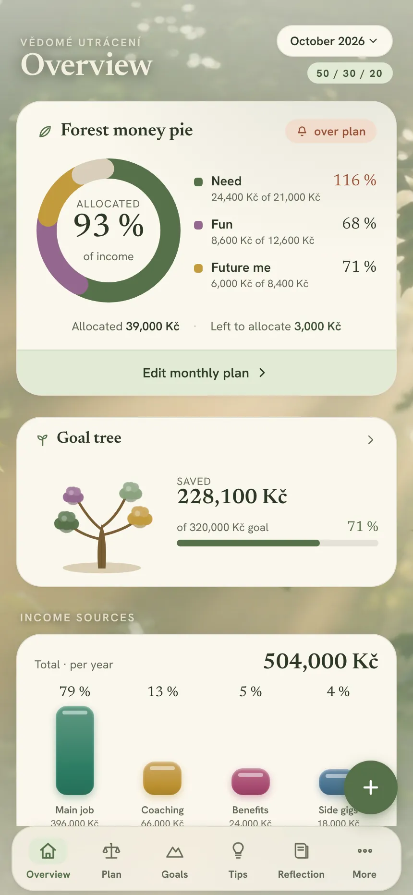
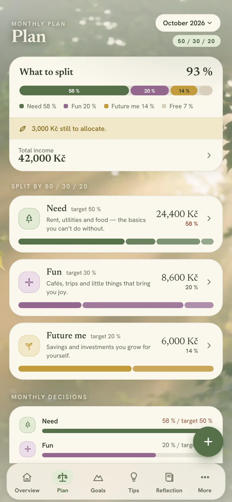
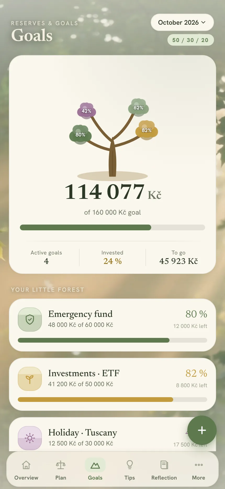

# Vědomé utrácení — Mindful Spending

**A calm, local-first money-planning app built on the 50/30/20 rule: what you need, what brings you joy, and what you send to your future self. Goals grow as a tree, tips teach without preaching, and your data never leaves your browser.**

[](https://vedome-utraceni.vercel.app/)
[](LICENSE)
[](https://github.com/usnea-communitas/vedome-utraceni/actions/workflows/ci.yml)
[](LICENSE-ASSETS.md)
[](#localisation)

**Use it:** <https://vedome-utraceni.vercel.app/> — installable as a PWA, no account, no server.

Vědomé utrácení (Czech for *mindful spending*) is an open-source project of [Usnea communitas, z. s.](https://usnea.ngo), a Czech nonprofit association for education, communities, nature and permaculture. It is built and maintained by [Martin Pazderník](https://github.com/martinpazdernik-source), and is used on its own and as a companion to financial-literacy workshops.

---

<p align="center">
  
  
  
</p>

## What it does

- **One plan, three jars.** Monthly income is split into *Need*, *Fun* and *Future me* with the proven 50/30/20 split as a starting point; the ratios are yours to adjust. The overview shows how much of the month is allocated and where each category stands.
- **Expenses in seconds.** A floating button opens a bottom sheet with curated and repeated suggestions; one-off expenses are recorded per day and month, and the overview recalculates immediately.
- **A goal tree, not a progress bar.** Every savings goal is a branch; foliage grows with each deposit, completed goals get a sparkle crown, and the whole tree sways gently.
- **Tips and a compounding simulator.** Short, kind tips (the 24-hour rule, pay your future self first, name your goals…) and an interactive compound-interest calculator for monthly contributions.
- **Monthly reflection.** A few gentle questions about how money felt this month, kept privately in the app.
- **Two moods.** A *Forest Calm* daytime theme and a *Wizard* night-academy theme, each with an ambient background and tuned motion; reduced motion is respected.
- **Privacy by design.** Everything is stored in the browser (`localStorage`) — there is no backend, no account and no analytics. An optional 4-digit PIN (stored only as a SHA-256 hash) locks the app on launch; backups can be exported and restored as a file; reminders are added to your own calendar as an `.ics` event.
- **Installable.** A PWA manifest and a service worker let the app open full-screen from the home screen and work offline.

## Localisation

English is the default interface language. The app also speaks **Czech** (the original language of the project), **Polish**, **Ukrainian** and **Spanish**; switch under *More → Language*. The choice is stored on the device and included in backups.

Strings live in [`fa-i18n.jsx`](fa-i18n.jsx): the Czech source text is the dictionary key and `L('…')` / `Lf('…', vars)` return the active language, falling back to Czech. Lookups tolerate the usual typographic differences (non-breaking spaces, „“ vs " quotes). To add a language, add its code to `FA_LANGS` and a translation to every entry; to fix a string, edit the entry and run `npm run compile`.

Amounts are shown in Czech crowns (Kč); the app was designed for Czech households and workshops.

## Tech stack and architecture

Plain React 18 with no framework. The JSX modules are precompiled with esbuild into a single `app.js`, and React's production builds are copied into `vendor/`, so the site is served as static files with no build step on the host.

| File | Role |
| --- | --- |
| `index.html` | Entry point: the whole design system (tokens, both themes, components' CSS), metadata, service-worker registration. |
| `fa-core.jsx` | Data model, formatting helpers, nature-inspired icons, demo profile. |
| `fa-i18n.jsx` | Lightweight localisation for five languages, language persistence. |
| `fa-store.jsx` | Persistent user-data layer: profile, plan, expenses, goals, reflections, backups. |
| `fa-prehled.jsx` | Overview screen — unified income/allocation card and the "forest money pie". |
| `fa-plan.jsx` | Interactive monthly plan: income rows, 50/30/20 split, planned items per category. |
| `fa-add.jsx` | Expense capture: floating button, bottom sheet, suggestions, recomputation. |
| `fa-tree.jsx` | Animated goal tree. |
| `fa-invest.jsx` | Compound-interest simulator. |
| `fa-screens.jsx` | Goals, Tips, Reflection and More screens. |
| `fa-settings.jsx` | PIN lock, reminders, backups, language and appearance settings. |
| `fa-onboard.jsx` | First-run onboarding: welcome → name → income → ratios → first goal → theme. |
| `fa-forest.jsx`, `fa-wizard.jsx` | The two ambient backdrops. |
| `fa-ui.jsx` | Shared UI primitives and micro-interactions. |
| `fa-app.jsx` | App shell: navigation, screen transitions, Tweaks panel, mount. |
| `ios-frame.jsx`, `tweaks-panel.jsx` | Device frame for desktop preview and the developer Tweaks panel. |
| `scripts/compile.mjs` | Precompiles the JSX sources into `app.js` and vendors React. |
| `sw.js`, `manifest.webmanifest` | Offline cache and PWA manifest. |

`app.js` and `vendor/` are generated and committed; **never edit `app.js` by hand** — change the `.jsx` sources and run `npm run compile`.

## Getting started

Requirements: Node.js 20+ and npm.

```sh
git clone https://github.com/usnea-communitas/vedome-utraceni.git
cd vedome-utraceni
npm ci
npm run compile          # rebuilds app.js and vendor/ from the .jsx sources
npx serve .              # or any static server; then open the printed URL
```

Open the site in a browser; on a phone-sized viewport the app fills the screen, on a desktop it sits inside a device frame. The developer *Tweaks* panel lets you switch themes, motion and load the sample profile.

## Deployment

The repository root is deployed as-is to Vercel (framework preset *Other*, no build, install or output settings). Any static host works the same way. Bump the `CACHE` name in `sw.js` when you ship a change so installed copies refresh their offline cache.

## Status

Feature-complete for everyday use: plan, expenses, goals, tips, reflections, PIN lock, backups, reminders and five languages are all in place. Ongoing work is testing with real users and small fixes; feedback from workshops is very welcome. There are no user statistics or testimonials to report — the app sends nothing anywhere, by design.

## Contributing

Bug reports, translation fixes and ideas for calmer money habits are welcome. Please read [CONTRIBUTING.md](CONTRIBUTING.md) (it explains the compile step and what we check), follow the [Code of Conduct](CODE_OF_CONDUCT.md), and report security concerns privately as described in [SECURITY.md](SECURITY.md).

## License

- **Code**: [MIT License](LICENSE), © 2026 Martin Pazderník.
- **Media** (the ambient background videos, the app icon and other artwork in `assets/`): [CC BY-NC-SA 4.0](LICENSE-ASSETS.md), © 2026 Martin Pazderník.
- React and the Google Fonts used by the design keep their own licences (MIT and SIL OFL respectively).

## About Usnea communitas

Usnea communitas, z. s. is a Czech nonprofit association (IČO 29953448) that develops educational projects about permaculture, financial literacy and urban nature. Its other open-source projects include [Le Jardin](https://github.com/usnea-communitas/le-jardin), a permaculture garden game, and [Zahrady Prahy](https://github.com/usnea-communitas/zahrady-prahy), an illustrated atlas of Prague's community gardens. More at <https://usnea.ngo>.
