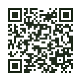

# Mindful Spending

A 50 / 30 / 20 money plan · workshop

---

## Today

One made-up story, five tasks:

1. Split the income
2. Find the leak
3. Set a goal
4. An unexpected expense
5. Looking back

Nobody has to talk about their own money.

---

## Where did the money go?

Do you know the feeling at the end of the month of not knowing where the money went?

---

## 50 / 30 / 20

- **Need 50 %** – housing, food, transport, phone
- **Fun 30 %** – coffee, cinema, subscriptions, gifts
- **Future me 20 %** – an emergency fund, goals, later investing

A starting frame, not a law. The ratios can be changed.

---

## Future me first

Right after payday, send a part to your future self. Spend only after that.

What is left over cannot be relied on.

The amounts in the stories are net income: what arrives in the account.

---

## Open the workshop

**vedome-utraceni.vercel.app/?workshop=1&lang=en**

Nothing to install, nobody signs in. The data stay on the phone and are deleted at the end.

---

## Pick a story

- **Ema, 19** – a student with a part-time job – 11,600 Kč a month
- **Tomáš, 20** – first paycheck – 27,500 Kč a month
- **Lucie, 24** – moving in together – 32,000 Kč a month

The people and the money are made up. Try whatever you like.

---

## 1 · Split the income

Overview → split the income in one tap.

In Plan, break at least one part into real items.

Write it on worksheet 1.

---

## Three kinds of expenses

- **Fixed** – the same every month: rent, phone
- **Controllable** – you decide as you go: coffee, delivery, shopping
- **One-off** – irregular, often unexpected: a repair, a fridge

---

## 2 · Find the leak

Which small thing added up the most?

**780 Kč a month = 9,360 Kč a year**

What could replace it so that the fun stays? Worksheet 2.

---

## 3 · Set a goal

**target amount ÷ monthly for Future me = number of months**

Ema: a driving licence · Tomáš: a three-month cushion · Lucie: a holiday together

Worksheet 3.

---

## 4 · An unexpected expense

Ema 2,490 Kč · Tomáš 1,800 Kč · Lucie 4,500 Kč

Which part pays for it? What will then be short of money?

An **emergency fund** is money set aside for exactly such moments.

---

## When the plan does not add up

Spend less · earn more · postpone · borrow

**Borrow: yes, no, or it depends?**

1. A new phone in instalments, because the old one is slow
2. Repairing a fridge you cannot cook without, when the fund is not enough
3. A holiday on a credit card
4. A loan to pay off another loan

**Ask yourself**

- Is it a need or a want?
- Can I repay it even in a worse month?
- How much extra will I pay? Compare the APRC.
- What if my income drops?

---

## 5 · Looking back

What could be done differently next month?

What will you take into your own plan?

Worksheet 4 is for you only.

---

## The end

Workshop → **End and delete**. On shared devices, always.

The questionnaire: anonymous, no signature.

Thank you.
